# Awesome HTTP Rule Modification & API Mocking 🚀

<p align="center">
  
</p>

<p align="center">
  <a href="https://github.com/ishandutta2007/Awesome-Awesome-Awesome"></a><a href="https://discord.gg/jc4xtF58Ve"></a>
  <a href="https://github.com/ishandutta2007/Awesome-HTTP-Rule-Modification-API-Mocking/stargazers"></a>
  <a href="https://github.com/ishandutta2007/Awesome-HTTP-Rule-Modification-API-Mocking/network/members"></a>
  <a href="https://github.com/ishandutta2007/Awesome-HTTP-Rule-Modification-API-Mocking/issues"></a>
  <a href="https://github.com/ishandutta2007/Awesome-HTTP-Rule-Modification-API-Mocking/blob/main/LICENSE"></a>
  <a href="https://github.com/ishandutta2007"></a>
</p>

---

## 🌟 Overview: Top HTTP Rule Modification & API Mocking Ecosystem

**A Curated List of Commercial SaaS Platforms & Open-Source GitHub Developer Tools**  
*Focused on HTTP/HTTPS Request Interception, Live Response Mocking, Reverse Proxies, Network Latency Simulation & Self-Hosted Debugging Proxies.*  
📅 **Last updated: March 2026**

This repository tracks the finest **commercial SaaS platforms** and **open-source developer utilities** designed for **HTTP Rule Modification & API Mocking**. Whether you need zero-configuration browser extensions that rewrite URLs and inject test headers on the fly, contract-based virtual mock servers for backend CI/CD pipelines, or full-blown scriptable Man-In-The-Middle (MITM) proxies for deep SSL inspection—this guide has you covered.

**Key use cases covered:**
- 🔄 **Request/Response Rewriting**: Modify headers, query parameters, status codes, and JSON/XML payloads dynamically.
- 🎭 **API Virtualization & Mocking**: Stand up local or hosted mock servers to decouple frontend engineering from backend delivery.
- ⚡ **Traffic Redirection & Injection**: Redirect production API calls to `localhost`, inject custom CSS/JS scripts, and test micro-frontends safely.
- ⏱ **Chaos Engineering & Latency Simulation**: Inject dropped connections, HTTP 500/504 errors, and bandwidth throttling into live staging apps.
- 🔒 **SSL/TLS Interception**: Decode and inspect encrypted HTTPS, HTTP/2, and WebSocket frames across web, mobile (iOS/Android), and IoT devices.

---

## 📑 Table of Contents
- [Sector Overview & Market Dynamics](#-sector-overview--market-dynamics)
- [SaaS/Hosted Platforms](#-saashosted-platforms)
- [Open-Source GitHub Projects](#-open-source-github-projects)
  - [Top Tier Open-Source Powerhouses](#-top-tier-open-source-powerhouses)
  - [Specialized Mocking & Client Testing Libraries](#-specialized-mocking--client-testing-libraries)
- [Feature Comparison & Selection Matrix](#-feature-comparison--selection-matrix)
- [How to Contribute](#-how-to-contribute)
- [Disclaimer & Security Best Practices](#-disclaimer--security-best-practices)
- [Star History](#-star-history)
- [Support & Sponsorship](#-support--sponsorship)

---

## 📊 Sector Overview & Market Dynamics

The global API management and testing ecosystem is estimated between **$8.6B and $13.5B** (projected to exceed **$37B+ by the early 2030s** at an ~18% CAGR), within which the specialized niche for API mocking, network virtualization, and contract simulation accounts for over **$100M–$230M+** in dedicated spending. 

Market dynamics exhibit **moderate fragmentation**: while overarching test automation and observability are anchored by massive enterprise conglomerates (such as Progress Software, BrowserStack, Postman, and SmartBear), client-side traffic modification and desktop proxy tooling remain intensely community-driven and fragmented, allowing high-performance indie utilities (e.g., Proxyman, Charles, mitmproxy) and hyper-focused developer extensions to thrive alongside enterprise suites rather than succumbing to a single "winner-take-all" platform.

---

## ☁️ SaaS/Hosted Platforms

The following SaaS and commercially licensed developer tools provide turnkey proxying, cloud collaboration, visual rule engines, and team management. Entries are ranked by **Company Size / Revenue / Valuation (Descending)**:

| Product | Company Size / Valuation / Scale | Starting Tier Price | Free Tier / Free Trial Limits | Description |
|:---|:---|:---|:---|:---|
| **[Requestly (BrowserStack)](https://requestly.com/)** | **~$4B Valuation** (~$225M–$235M+ ARR; backed by BrowserStack) | **$10/user/month** (Team plan, billed annually; or ~$12–$15 monthly) | **Free Forever plan**: Limited to 3 active rules (max 5 saved rules), 5 API mock endpoints, 5 hosted JS/CSS files, unlimited header modifications & API client (non-commercial use). | **Browser-native HTTP interception and API mocking without proxy setup.** Trusted by **300,000+ developers**; acquired by BrowserStack in May 2025. **Core features**: mock REST/GraphQL APIs, modify request/response headers and bodies, redirect URLs, inject scripts, block requests, and simulate delays. **No system proxy or SSL certificates required**—works through corporate VPNs. Open-source core available on GitHub. |
| **[Fiddler Everywhere](https://www.telerik.com/fiddler)** | **~$1.79B Market Cap** parent company (*Progress Software Corporation*, NASDAQ: PRGS; ~$980M TTM Revenue) | **$7/user/month** (Lite, billed annually / $10/mo monthly); **$13/user/month** (Pro, billed annually / $19/mo monthly for traffic manipulation/Rules) | **Free Trial**: 10-day evaluation trial with full feature access (limited to 1 machine activation, non-commercial evaluation only). No free forever plan. | Cross-platform web debugging proxy with visual Rules builder. **Lite does not include traffic manipulation through Rules**—that requires **Pro**. Inspect HTTP/HTTPS traffic, decrypt SSL sessions, mock API responses, compose requests, and share team debugging logs. Available on macOS, Windows, and Linux. |
| **[Proxyman](https://proxyman.com/)** | **Bootstrapped Indie / ~$576K–$915K ARR** (Profitable, self-funded by Noah Tran) | **$89** (one-time perpetual standard license for 1 seat/device, includes 1 year of updates) | **Free Forever tier (Personal use)**: Max 2 pinned domains/apps, max 1 active rule per debugging feature (Map Local, Breakpoints, Scripting, etc.); no new tabs. Commercial evaluation is limited to a 2-week free trial. | Native macOS/Windows/Linux HTTPS debugging proxy with mock, script, and reverse-proxy capabilities. Built natively in Swift/C++ for optimal performance and minimal memory footprint. Offers automatic SSL certificate installation, Map Local/Remote, JavaScript scripting, GraphQL debugging, and Model Context Protocol (MCP) support for AI agents. |
| **[Charles Proxy](https://www.charlesproxy.com/)** | **Bootstrapped Indie** (Privately held by XK72 Ltd / Karl von Randow; creators of Letterboxd) | **$50/license** (single-user perpetual license for v5; upgrades ~$20/license; site license $400) | **Free Trial**: 30-day evaluation with full features. Unlicensed/post-trial usage is limited to 30-minute sessions with startup delay prompts. | Classic desktop Java-based HTTP proxy / HTTP monitor / Reverse Proxy with per-host SSL proxying, bandwidth throttling, breakpoint editing, and rewrite rules. Charles 5 brings Apple Silicon native compilation, MSIX Windows packaging, and enhanced HTTP/2 support. |

---

## 💻 Open-Source GitHub Projects

Explore the most popular open-source repositories for self-hosted traffic modification, mock servers, and debugging proxies. Sorted strictly by **GitHub Star Count (Descending)**:

### 🏆 Top Tier Open-Source Powerhouses

| Project | Star Badge | Description |
|:---|:---:|:---|
| **[JSON Server](https://github.com/typicode/json-server)** | [](https://github.com/typicode/json-server/stargazers) | **Get a full fake REST API with zero coding in less than 30 seconds.** Created by Typicode. Generates full CRUD routes, relationships, pagination, sorting, and full-text search directly from a plain JSON file. Perfect for quick front-end prototyping, automated UI tests, and offline development mock APIs. |
| **[mitmproxy](https://github.com/mitmproxy/mitmproxy)** | [](https://github.com/mitmproxy/mitmproxy/stargazers) | **The industry standard open-source scriptable MITM proxy for automated rule modification and mocking.** **MIT licensed**, Python. Features three interfaces: `mitmproxy` (interactive console for HTTP/1, HTTP/2, WebSockets), `mitmweb` (browser UI), and `mitmdump` (headless for CI pipelines). Python addons receive every network flow as a mutable object—rewrite responses, mock endpoints, or log traffic programmatically. Ideal for automated testing and CI/CD security workflows. |
| **[Yaak](https://github.com/mountain-loop/yaak)** | [](https://github.com/mountain-loop/yaak/stargazers) | **Modern, lightning-fast desktop REST, GraphQL, and gRPC client with mock and interception support.** Built with Rust and Tauri for near-zero memory footprint and blazingly fast startup times. Supports environment templating, visual request inspection, and local response virtualization. |
| **[Mock Service Worker (MSW)](https://github.com/mswjs/msw)** | [](https://github.com/mswjs/msw/stargazers) | **Seamless REST/GraphQL API mocking library using Service Workers.** Intercepts requests at the network level right in the browser or Node.js runtime without touching application code or setting up separate proxy servers. Enables identical mock definitions across unit tests, E2E testing (Playwright/Cypress), and local Storybook development. |
| **[Whistle](https://github.com/avwo/whistle)** | [](https://github.com/avwo/whistle/stargazers) | **Node.js-based cross-platform web debugging proxy with a powerful browser UI for rule modification.** **MIT licensed**, actively maintained. Supports HTTP, HTTPS, HTTP/2, and WebSocket protocols. Rule-based interception allows developers to rewrite requests, mock responses, redirect URLs, inject scripts, and replace response bodies using standard Hosts-style rules. |
| **[Nock](https://github.com/nock/nock)** | [](https://github.com/nock/nock/stargazers) | **HTTP server mocking and expectations library for Node.js.** Overrides Node's native `http.request` module to intercept outgoing HTTP calls in unit/integration tests. Allows developers to assert request payloads, simulate network latency, test timeouts, and verify error responses with zero external proxy dependencies. |
| **[Polly.js](https://github.com/Netflix/pollyjs)** | [](https://github.com/Netflix/pollyjs/stargazers) | **Record, replay, and stub HTTP interactions with Node and browser support.** Built by Netflix. Combines the speed of recorded network fixture replays with the flexibility of dynamic API mocking, request modification, and granular recording adapters for Fetch, XHR, and Puppeteer. |
| **[Mockoon](https://github.com/mockoon/mockoon)** | [](https://github.com/mockoon/mockoon/stargazers) | **Open-source API mocking desktop application with zero configuration.** Create unlimited mock REST APIs locally with custom headers, status codes, route regex rules, templated response bodies, and latency emulation. Features `mockoon/cli` for deploying mock collections directly into headless CI/CD and Docker environments. |
| **[AnyProxy](https://github.com/alibaba/anyproxy)** | [](https://github.com/alibaba/anyproxy/stargazers) | **Fully configurable HTTP/HTTPS proxy in NodeJS.** Created by Alibaba. Provides a web-based inspection console and allows developers to write custom JavaScript rules to manipulate HTTP traffic on the fly, intercept mobile application requests, and replace live response data. |
| **[WireMock](https://github.com/wiremock/wiremock)** | [](https://github.com/wiremock/wiremock/stargazers) | **Flexible tool for building mock APIs, stubbing HTTP services, and simulating edge cases.** Java-based enterprise standard for service virtualization. Supports stateful behavior simulation, dynamic templating, proxy passthrough with recording, fault injection (delays, truncated responses), and comprehensive Docker/JVM deployment. |
| **[Requestly (Open Core)](https://github.com/requestly/requestly)** | [](https://github.com/requestly/requestly/stargazers) | **Open-source core of Requestly's browser extension and desktop proxy.** Intercept and modify network requests, redirect URLs, insert custom headers, mock API endpoints, and swap script sources directly inside Chrome, Firefox, Safari, and Brave without requiring system root certificates. |
| **[VCR](https://github.com/vcr/vcr)** | [](https://github.com/vcr/vcr/stargazers) | **Record your test suite's HTTP interactions and replay them during future test runs.** The foundational Ruby gem that popularized the "cassette" pattern for deterministic, blazingly fast integration tests without hitting real third-party endpoints. Inspired ports across every major programming language. |
| **[MockServer](https://github.com/mock-server/mockserver)** | [](https://github.com/mock-server/mockserver/stargazers) | **Easy mocking and proxying of any HTTP or HTTPS system via Java, JavaScript, or REST API.** Allows developers to mock responses, record interactions, verify that specific requests were sent, and run as a standalone Docker container, Helm chart, or embedded JUnit test runner. |
| **[HTTP Toolkit](https://github.com/httptoolkit/httptoolkit)** | [](https://github.com/httptoolkit/httptoolkit/stargazers) | **Polished open-source HTTP(S) debugging proxy, analyzer, and client.** **AGPL-3.0** desktop app powered by the open-source `mockttp` library. Offers one-click automatic interception for browsers, Node.js, Python, Ruby, Docker, and Android apps, with interactive breakpoint editing and rule-based request rewriting. |
| **[Mountebank](https://github.com/bbyars/mountebank)** | [](https://github.com/bbyars/mountebank/stargazers) | **Over the wire test doubles in Node.js for HTTP, HTTPS, TCP, and SMTP.** Multi-protocol service virtualization tool that requires no client SDKs. Allows teams to stand up imposters with stubs, simulate network latency, record and replay dependencies, and assert interactions over standard protocols. |

---

### 🧩 Specialized Mocking & Client Testing Libraries

| Project | Star Badge | Description |
|:---|:---:|:---|
| **[ModHeader](https://addons.mozilla.org/en-GB/android/addon/modheader-by-modheader-app/)** | — | **Browser extension for rapid HTTP header modification.** Modify, add, edit, remove, and override request and response headers (User-Agent, Authorization, CORS headers, CSP policies) without changing application source code or installing system proxies. |

---

## 🎯 Feature Comparison & Selection Matrix

Choosing the right tool depends on your team's architecture, security constraints, and testing objectives:

```
                            ┌─────────────────────────────────┐
                            │  Where does interception occur?  │
                            └────────────────┬────────────────┘
                                             │
             ┌───────────────────────────────┴───────────────────────────────┐
             ▼                                                               ▼
   [ Inside Browser / App ]                                        [ System / MITM Proxy ]
   - No SSL certificates needed                                   - Captures all system traffic
   - Works across corporate VPNs                                  - Mobile (iOS/Android) & IoT ready
   - Tools: Requestly, MSW, ModHeader                             - Tools: Proxyman, mitmproxy, Whistle, Charles
```

- 💡 **Best for Frontend Developers (Zero Setup)**: **Requestly** or **MSW** — intercept requests at the browser layer without configuring system proxy settings or dealing with self-signed SSL certificate prompts.
- ⚙️ **Best for CI/CD & Headless Automation**: **mitmproxy** (`mitmdump`) or **WireMock** — spin up headless mock servers directly in Docker containers or GitHub Actions pipelines.
- 🖥 **Best Native Desktop GUI Experience**: **Proxyman** (macOS/Win/Linux) or **HTTP Toolkit** — clean UI with automated proxy configuration, SSL certificates helper, and WebSocket frame decoding.
- 🔌 **Best for Contract & Schema Mocking**: **JSON Server** or **Mockoon** — rapidly synthesize fake REST APIs with realistic relational data and zero backend code.

---

## 🤝 How to Contribute

We welcome additions, corrections, and updates from the developer community!

1. 🍴 Fork the repository.
2. 📝 Add or update entries in `README.md` (ensure SaaS entries include specific starting pricing and free tier limits; ensure open-source entries include valid GitHub star badges).
3. 🔗 Keep descriptions objective, accurate, and link directly to official project repositories or homepages.
4. 🚀 Submit a Pull Request with a clear explanation of your changes.

---

## 🛡 Disclaimer & Security Best Practices

- This repository is a **community-curated index** provided for educational and testing purposes.
- HTTP rule modification tools intercept sensitive traffic containing credentials, session cookies, and personal data. **Only intercept and modify traffic on systems, endpoints, and applications you own or have explicit authorization to test.**
- Always uninstall or deactivate generated root CA certificates from test devices and emulators once debugging sessions conclude.

---

## 📈 Star History

[](https://www.star-history.com/#ishandutta2007/Awesome-HTTP-Rule-Modification-API-Mocking&type=date&legend=top-left)

---

## 💖 Support & Sponsorship

If this curated ecosystem helps simplify your API testing, debugging, or network mock workflows, please consider supporting the project:

- ⭐ **Star this repository** to help other developers discover it!
- 🍴 **Fork and share** with your teammates and engineering community.
- ☕ **Sponsor or Buy Me a Coffee**: Support ongoing maintenance via the [GitHub Sponsor Dashboard](https://github.com/sponsors/ishandutta2007).

Thank you for being part of the open-source developer tooling community! 🚀
